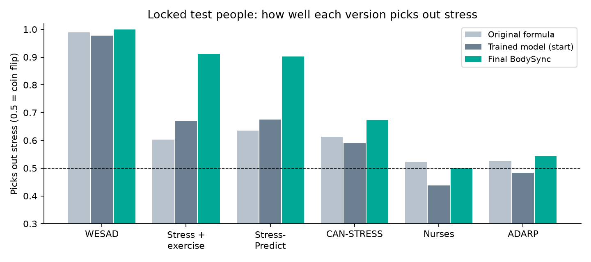
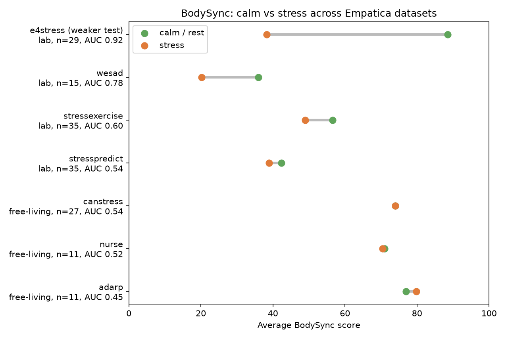
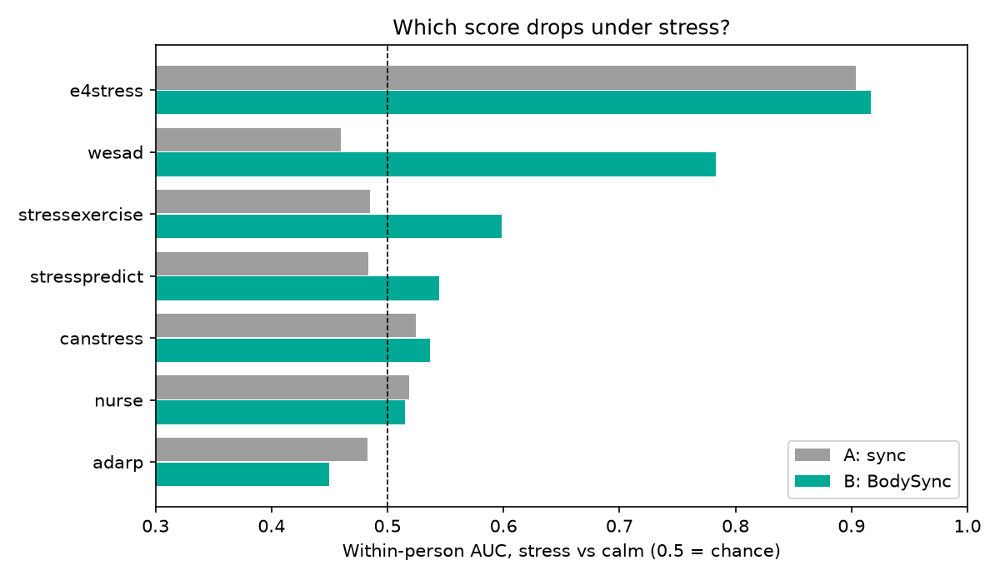

# BodySync

A 0–100 score for how far your body is from **your own normal** right now, from wrist heart rate, sweat (EDA) and skin temperature. 100 means exactly your normal; lower means further away in the stressed direction. Built on everyday Empatica EmbracePlus data (ZU-PWD '25) and tested on public Empatica E4 stress datasets.

## Final system (final presentation)

`src/final_eval.py`. The deck is `docs/slides/BodySync_Final.pptx` (PDF copy alongside) and the report is `report/BodySync_Final_Report.tex`, compiled as `report/BodySync_Final_Report.pdf`. To compile it elsewhere (e.g. Overleaf), upload `figures/fig7_example_person.png` with it.

The deck and report present the four main studies (WESAD, Stress + exercise, Stress-Predict, CAN-STRESS) plus real driving. The nurse and ADARP studies had only 4 locked test people each and scored near a coin flip; they are kept below for the record and mentioned in the report's limitations.

In the deck and report, "first version" means the **plain formula without sweat bursts**, scored on the same people (`src/plain_formula.py` → `results/plain_formula.csv`): locked test WESAD 0.92, Stress + exercise 0.63, Stress-Predict 0.62, CAN-STRESS 0.59 (average 0.69); driving city vs highway 0.54. The step-by-step chart (deck slide 9) averages the four main studies on DEV (rounds 15–16 in `results/iteration_log.csv`) and driving (`results/driving_order_self_last.csv`).

The sections after "The score" record the earlier stages: the sync idea, the first formula, and the richer features. Their numbers come from before the final push.

**What it does:**
1. **Your normal:** each person's own median and typical spread of every input (one normal per person; per-situation normals were tried and didn't help).
2. **Stress signals measured against it:** sweat bursts, fast vs slow sweat, in-window trends, and change over the last 10 min.
3. **A trained XGBoost model** that adapts to each person through self-training on their unlabelled windows.
4. **A smoothed score.**

**How it was tested:**
- **Locked split:** before iterating, 40% of people in each dataset were locked away (`results/final_split.csv`, committed first).
- **Iteration:** every idea was tried on the other 60% and logged in `results/iteration_log.csv`. An idea was kept only if it raised the average and dropped no dataset by more than 0.03. Iteration stopped after two rounds with gains under 0.01.
- **The frozen system** was then scored once on the locked people (`results/final_test.csv`).

| Locked test people | People | First version (formula + bursts) | Trained model (start) | **Final** |
|---|---|---|---|---|
| WESAD | 6 | 0.99 | 0.98 | **0.99+** |
| Stress + exercise | 14 | 0.60 | 0.67 | **0.91** |
| Stress-Predict | 14 | 0.64 | 0.67 | **0.90** |
| CAN-STRESS | 10 | 0.61 | 0.59 | **0.67** |
| Nurse stress* | 4 | 0.52 | 0.44 | 0.50 |
| ADARP* | 4 | 0.53 | 0.48 | 0.55 |
| **Average, four main studies (≥ 5 test people)** | | 0.71 | 0.73 | **0.87** |
| Average, all six | | 0.65 | 0.64 | 0.76 |

\* Too few test people to judge. Resampling people gives a 95% range of 0.29–0.65 for nurses and 0.49–0.61 for ADARP (`results/audit.csv`). The all-six average is the one fixed before testing; the four-study average was added afterwards to set these two aside.

Notes:
- **Leak check:** with each person's labels shuffled, the final system scores 0.51.
- **Personal calibration** (a few "stressed? yes/no" answers) helped on DEV but not on the locked people (0.84 → 0.83), so it is not part of the final system.
- **EmpaticaE4Stress** is left out: its only calm windows are the baseline that sets the normal.
- **WESAD** reads 0.99+ because its 6 test people face a very strong stressor; even the simple first version gets 0.99.
- **v2, an everyday-life push** (rounds 5–7 on DEV: pool the everyday datasets, lab data as a low-weight helper, stronger self-training, averaging XGBoost with logistic regression) raised the everyday DEV average from 0.613 to 0.637. On a second, disclosed look at the locked people (`results/final_test_v2.csv`) it did not hold up: nurses 0.46, ADARP 0.59, CAN-STRESS 0.65, everyday average 0.567 vs 0.573 for v1. So **v1 stays the final system**.
- **Trained only on other datasets,** v2 gets WESAD 0.74 on the locked people. The change-over-10-min features don't transfer well between studies.



### Checks after the freeze: is it stress or a shortcut?

`src/audit.py` → `results/audit.csv`. Nothing here changes the frozen system. A shortcut is something that comes with stress in a study without being stress: moving during a talk task, or stress always coming before the rest periods.

| Check (locked test people) | WESAD | Stress + exercise | Stress-Predict | CAN-STRESS |
|---|---|---|---|---|
| Final system | 0.999 | 0.91 | 0.90 | 0.67 |
| Without wrist movement | 0.999 | 0.91 | 0.88 | 0.67 |
| Leaving out rest right after a stressor | 0.999 | 0.91 | 0.90 | – |
| A model given only movement | 0.97 | 0.46 | 0.55 | 0.46 |
| A model given only the clock | 0.97 | 0.78 | 0.96 | 0.59 |
| 95% range (resampling people) | 0.996–1.0 | 0.85–0.97 | 0.85–0.95 | 0.52–0.83 |

- **Lab results stand:** they hold without movement and without the recovery periods. The clock alone can also separate some lab protocols, because stress always comes at the same point. BodySync never sees the clock, but those datasets can't rule out that it partly tracks something that drifts with time.
- **CAN-STRESS:** calm reports cluster in the evening (hour of day alone scores 0.74 over all people). With stress and calm matched to the same hour, too few people are left (5 DEV, 2 TEST) to tell.
- **ADARP:** stress labelled only from the 15 min *before* a button press (no press movement) gives 0.50 instead of 0.55.
- **Self-training** gives the same results when it uses all of a person's windows, so its choice of windows doesn't leak labels.
- **Seed noise:** retraining with 5 seeds moves the DEV average by SD 0.002.

**Rounds 8–9 (everyday life, DEV only; `results/iteration_log.csv`, `results/iteration_events.csv`):** none passed the keep rule.
- **A past-only normal** (previous 1 or 3 days of wear): CAN-STRESS 0.65 → 0.50.
- **Training on the tested contrast:** +0.007.
- **Longer smoothing:** no gain.
- **Scoring only while still** (below the person's own median movement): DEV +0.014, but its third, disclosed look at the locked people (`results/final_test_v3.csv`) scored fewer people, and on the same people it was not consistently better (ADARP no gain).

**v1 stays the final system.**

### A brand-new dataset: real driving (AffectiveROAD)

Added after the system was frozen; nothing was tuned on it (`src/new_datasets.py`, run once; `results/new_datasets.csv`). AffectiveROAD (El Haouij et al., ACM SAC 2018, MIT Media Lab, 125 citations) has 9 drivers and 13 real drives, with an Empatica E4 on each wrist and 15 min of rest before and after. City segments count as stress, the last rest as calm and the first rest as the normal (`src/datasets/affectiveroad.py`). The dataset's own continuous stress rating agrees: city 0.70–0.84, highway about 0.5.

| AffectiveROAD (all 9 drivers are new) | First version | Final, trained on the other drivers | Final, never saw this dataset |
|---|---|---|---|
| City vs highway (both driving) | 0.73 | 0.61 | **0.76** |
| City vs resting afterwards | 0.83 | **0.92** (9/9 drivers lower) | 0.67 |
| Shuffled labels | | 0.55 | |

- **City vs highway is the fairest real-world test:** both are driving, and the shortcuts can't explain it. Movement alone scores 0.38; it runs the other way, because highway windows move more. Time since the start alone scores 0.50.
- **City vs rest is partly movement:** driving vs parked; movement alone scores 0.90.
- **BodySync doesn't follow the dataset's moment-to-moment stress rating within a drive:** `src/driving_tracking.py`, `results/driving_tracking.csv`, mean r ≈ 0.1, 7/13 drives. The rating itself mostly rises with time.

BIG IDEAS (Duke, PhysioNet) was also checked. It has 10 days of E4 data per person but no stress labels (it's a glucose study), so it can't test stress detection.

## The score

`src/bodysync.py` computes two candidate scores the same way, so they can be compared:
- **Score A, sync:** the original idea. Do heart rate, sweat and temperature *move together* as usual? Its inputs are the Pearson r of each signal pair inside the window, and a change in either direction counts.
- **Score B, BodySync:** the final score, described in the steps below.

1. **Per window:** take the average heart rate, sweat (log scale) and skin temperature.
2. **Find the person's normal for the same situation.** In ZU-PWD the watch reports the situation (asleep / resting / active / other). Normal is that person's median, and their typical spread (MAD), across all their windows in that situation. If a situation has fewer than 10 windows, the person's overall normal is used instead. Comparing exercise with the person's own exercise stops a workout from looking like stress.
3. **Count only changes in the stress direction:** heart rate up, sweat up, skin temperature down. Being calmer than normal costs nothing.
4. **Distance** = root-mean-square of the three "spreads away from normal" values. **Score** = 100 / (1 + distance / 2), so 2 spreads away gives 50.
5. **Reason:** the signal furthest from normal is reported with the score, for example "sweat high".

## Why not the original "sync" idea

The project started as a sync score: do heart rate, sweat and temperature *move together* as usual? `src/coupling_test.py` tested this on ZU-PWD. XGBoost told sleep, rest and activity apart from 30-min windows, and each person was tested after training on the others (leave-one-subject-out).

| Features | Sleep / rest / active | Sleep vs rest |
|---|---|---|
| Coupling only (how signals move together) | 0.37 | 0.56 |
| Levels (mean, SD) | 0.81 | 0.83 |
| Levels + personal normal | 0.83 | 0.88 |
| Levels + personal normal + coupling | 0.84 | 0.88 |

Balanced accuracy; chance is 0.33 and 0.50.

- **Coupling alone is near chance.**
- **Adding coupling to the other features gains about half a point per person.** That gain is statistically detectable for sleep / rest / active (13 of 20 people, p = .007) but not for sleep vs rest (p = .33).
- **The coupling values themselves barely differ between states** (`fig2`, `results/features_by_state.csv`).

How high or low the signals are carries the information, not how they move together. So the score uses levels compared with a personal normal.

## Results

### ZU-PWD: everyday life, no stress labels

`src/validate_zupwd.py`

- **Exercise:** with situation-aware normals, the median score while active is 78.6, the same as other situations (76–79). With one normal for everything, it drops to 62.8 and exercise looks like stress.
- **Sleep:** neither score is lower on the day after nights with more wake-ups, more time awake or less sleep (12 people, all p ≥ .42).
- **Stress can't be tested here:** the free copy of the data has no stress labels.

### Seven public Empatica stress datasets (first version of the score)

`src/validate_datasets.py`, one loader per dataset in `src/datasets/`.

AUC = how well a lower score picks out a person's stress windows from their calm ones (0.5 = chance). Lab datasets compare stress with *later* rest, not with the baseline that set the normal. For the nurse dataset, stress intervals were first flagged by the authors' sweat detector. The fair test there compares flagged intervals where the nurse felt stressed with flagged intervals where they didn't.

| Dataset | Citations* | Setting | People | A: sync AUC | B: BodySync AUC | Lower in stress (B) |
|---|---|---|---|---|---|---|
| WESAD (Schmidt 2018) | 1,352 | lab | 15 | 0.46 | **0.78** | 12 of 15 (p = .004) |
| Nurse stress (Hosseini 2022, *Sci Data*) | 119 | hospital shifts | 11 | 0.52 | 0.52 | 7 of 11 (p = .77) |
| Stress-Predict (Iqbal 2022, *Sensors*) | 113 | lab | 35 | 0.48 | 0.54 | 19 of 35 (p = .34) |
| Stress + exercise (Hongn 2025, *Sci Data*) | 37 | lab | 35 | 0.49 | 0.60 | 21 of 35 (p = .016) |
| EmpaticaE4Stress (Campanella 2024, *Data in Brief*) | 26 | lab | 29 | 0.90† | 0.92† | 28 of 29 |
| ADARP (Sah 2022) | 13 | daily life | 11 | 0.48 | 0.45 | 4 of 11 (p = .24) |
| CAN-STRESS (Rahimi Azghan 2025) | 1 | daily life | 27 | 0.52 | 0.54 | 18 of 27 (p = .49) |

\* OpenAlex, November 2026.
† Weaker test: this dataset has no later rest, so stress is compared with the baseline that set the normal.

**Exercise in the stress + exercise dataset:** cycling scores lower (median 17) than the stress tasks (45). Lab sessions have no "exercising normal" to compare with, unlike ZU-PWD.




### Richer features, and the everyday-life datasets

`src/feature_test.py`, `results/feature_test.csv`, with the features computed in `src/datasets/richer.py`. All variants were fixed before looking at the results:
- **Sweat bursts:** skin conductance responses, measured as rate and size, from the raw 4 Hz EDA.
- **HRV:** RMSSD from inter-beat intervals.
- **A trained XGBoost model** on the distance-from-normal inputs.
- **"+ change":** the same model, plus how much each input changed over the last ~10 minutes and movement relative to the person's usual.

The trained models are tested two ways:
- **New dataset:** trained on the lab datasets only, never on the test dataset. For the everyday-life datasets, all 4 lab sets.
- **New people:** leave-one-subject-out inside the test dataset.

| Variant | WESAD | Stress + exercise | Stress-Predict | E4Stress† | Nurse* | ADARP | CAN-STRESS |
|---|---|---|---|---|---|---|---|
| B | 0.78 | 0.60 | 0.54 | 0.92 | 0.52 | 0.45 | 0.54 |
| B + bursts | 0.87 | 0.61 | 0.56 | 0.98 | 0.57 | 0.49 | 0.54 |
| B + bursts + HRV | 0.87 | 0.64 | 0.56 | 0.99 | 0.57 | 0.49 | 0.54 |
| Trained, new dataset | **0.94** | 0.72 | 0.66 | 0.99 | 0.52 | 0.52 | 0.57 |
| Trained, new people | 0.97 | 0.71 | 0.66 | 1.00 | 0.52 | 0.57 | 0.64 |
| Trained + change, new dataset | 0.84 | 0.73 | 0.67 | 0.95 | 0.50 | 0.50 | 0.52 |
| Trained + change, new people | 0.97 | **0.81** | **0.81** | 0.99 | 0.54 | 0.57 | **0.65** |

\* Felt stress vs flagged but not stressed. † Weaker test.

- **Lab:** sweat bursts give the biggest single gain on WESAD. A model trained on other datasets reaches 0.94 there. The change features help a lot within a dataset (0.81) but hurt when moving to a new dataset (WESAD 0.94 → 0.84).
- **Everyday life:** a model trained on lab stress does **not** transfer (0.50–0.57). Lab stress and everyday stress look different. Trained on other people from the same everyday-life dataset, it does a little better:
  - CAN-STRESS: 0.65, lower under stress for 20 of 27 people, p = .007;
  - ADARP: 0.57, 9 of 11 people, p = .04;
  - nurses: no gain.
- **Caveat:** many variants were tested, so single p-values near .05 should be read with caution.
- **HRV** adds little: wrist-pulse HRV is noisy.

### What this stage showed (before the final push)

- **The sync score (A) is at chance on every fair test,** including WESAD.
- **BodySync (B) catches acute stress on WESAD,** the field's standard benchmark, and weakly on the other lab datasets.
- **On everyday stress (nurses, ADARP, CAN-STRESS) it is at chance.** Average heart rate, sweat and temperature look the same in moments people reported as stressful and in calm ones. This matches the well-known problem that wearable stress detection rarely carries over to new datasets.
- **So BodySync measures "how different is your body from your normal"**: it catches strong physical stress responses, but it isn't an everyday stress detector.
- The final system (top of this page) later raised lab results to about 0.9 on every dataset and CAN-STRESS to 0.67, and scored 0.76 on city vs highway driving in a dataset it never saw.

## Limitations

- **The normal uses the whole recording,** including future data and the window being scored. A real app would need a past-only or calibration-period normal.
- **A past-only rolling normal was tried for everyday life** (round 8) and did worse, so the final system keeps the whole-recording normal.
- **The final system can't run on ZU-PWD** (no raw 4 Hz sweat signal), so the "what a user sees" week uses the basic formula.
- **The normal is fixed, not rolling,** so slow drift (over weeks, or within a lab session) isn't handled.
- **ZU-PWD states come from Empatica's own sleep and activity algorithms,** not ground truth. A window gets a state only if at least 70% of its minutes share it; otherwise it is "other".
- **ZU-PWD has only one reading per minute,** and EDA is often near the sensor floor. All the external datasets use the older E4 watch.

## Running it

```
pip install -r requirements.txt
python src/datasets/<name>.py      # once per downloaded dataset (see below)
python src/run_all.py              # ZU-PWD pipeline + scoring of all converted datasets
python src/feature_test.py         # richer features + trained model
python src/final_eval.py --round N # final push on DEV people (N = 1, 11, 2-9); --final = locked test
python src/new_datasets.py         # frozen system on AffectiveROAD
python src/driving_tracking.py     # frozen system vs AffectiveROAD's moment-to-moment stress rating
python src/audit.py                # shortcut checks, seed noise, 95% ranges
```

XGBoost uses all CPU threads, which reproduces the frozen numbers. `BODYSYNC_THREADS=4` is quieter but shifts results slightly.

| Step | File |
|---|---|
| Clean ZU-PWD, label each minute (sleep / rest / active / other) | `src/clean.py` |
| 30-min windows (sliding 15), level and coupling features | `src/features.py` |
| Figures 1–2, features by state | `src/explore.py` |
| Does coupling beat levels? | `src/coupling_test.py` |
| The score | `src/bodysync.py` |
| Score on ZU-PWD: exercise and sleep checks, fig 3 | `src/validate_zupwd.py` |
| Both scores on all external datasets, figs 4–5 | `src/validate_datasets.py` |
| Sweat bursts, HRV and a trained model on the lab datasets | `src/feature_test.py` |
| Final push: locked split, iteration log, locked test | `src/final_eval.py` |
| Frozen system on a brand-new dataset (AffectiveROAD) | `src/new_datasets.py` |
| Moment-to-moment stress rating while driving | `src/driving_tracking.py` |
| Shortcut checks, seed noise, 95% ranges | `src/audit.py` |
| Report tables + single-file Overleaf version | `report/make_tables.py` (after compiling `report/main.tex`) |

### Getting the data

The datasets aren't in this repo because of their size and licences.

| Dataset | Source | Put it in |
|---|---|---|
| ZU-PWD '25 | see `data/DATASET_SOURCE.md` | `data/final_merged_2024_to_2025.csv` |
| WESAD | https://uni-siegen.sciebo.de/s/HGdUkoNlW1Ub0Gx | `data/wesad/WESAD.zip` |
| Nurse stress | https://doi.org/10.5061/dryad.5hqbzkh6f (browser download) | `data/external/nurse/` |
| ADARP | https://zenodo.org/records/6640290 | `data/external/adarp/` |
| CAN-STRESS | https://zenodo.org/records/14842061 | `data/external/canstress/` |
| Stress + exercise | https://physionet.org/content/wearable-device-dataset/1.0.1/ | `data/external/stressexercise/` |
| Stress-Predict | https://github.com/italha-d/Stress-Predict-Dataset | `data/external/stresspredict/` |
| EmpaticaE4Stress | https://doi.org/10.17632/kb42z77m2g.2 | `data/external/e4stress/` |
| AffectiveROAD | https://www.media.mit.edu/groups/affective-computing/data/ | `data/external/affectiveroad/` |

Each loader's docstring explains its file layout and labelling rules. They all write the common format in `src/datasets/SPEC.md`.

## Layout

```
src/            pipeline; src/datasets/ has one loader per external dataset
results/        result tables
figures/        fig1 typical day, fig2 coupling by state, fig3 example week, fig4 all datasets, fig5 sync vs BodySync, fig6 final locked-test results
report/         BodySync_Final_Report.tex/.pdf = final 5-page report; main.tex (+ refs.bib, tables/) = full earlier report, overleaf.tex = the same as one file; archive/ = progress report
docs/           paper summary, related work; slides/BodySync_Final.pptx = final deck, slides/archive/ = earlier weekly and progress decks
data/           datasets (not in git)
```
