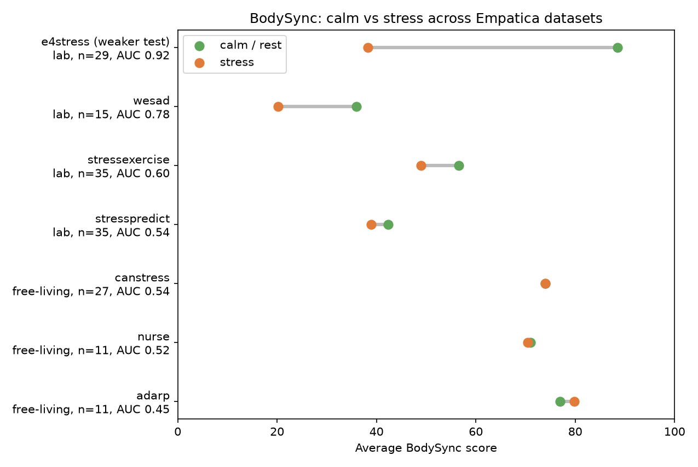
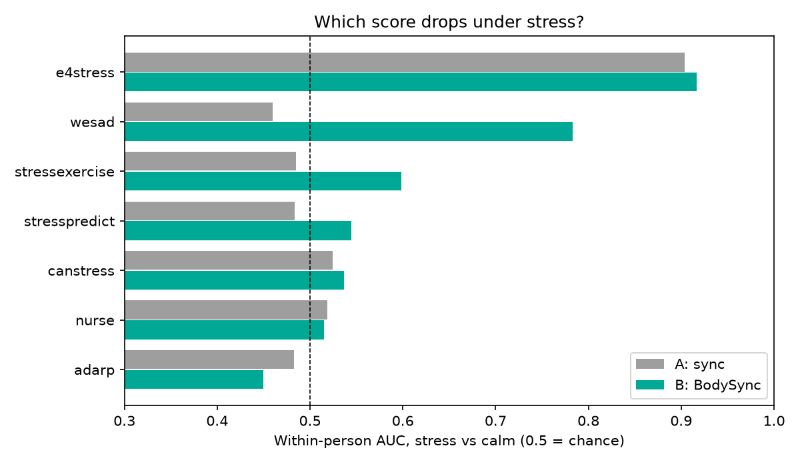

# BodySync

A 0–100 score for how far your body is from **your own normal** right now, from wrist heart rate, sweat (EDA) and skin temperature. 100 means exactly your normal; lower means further away in the stressed direction. Built on everyday Empatica EmbracePlus data (ZU-PWD '25) and tested on 7 public Empatica E4 stress datasets.

## The score

`src/bodysync.py` computes two candidate scores the same way, so they can be compared:
- **Score A, sync:** the original idea. Do heart rate, sweat and temperature *move together* as usual? Its inputs are the Pearson r of each signal pair inside the window, and a change in either direction counts.
- **Score B, BodySync:** the final score, described in the steps below.

1. **Per window:** take the average heart rate, sweat (log scale) and skin temperature.
2. **Find the person's normal for the same situation.** In ZU-PWD the watch reports the situation (asleep / resting / active / other). Normal is that person's median, and their typical spread (MAD), across all their windows in that situation. If a situation has fewer than 10 windows, the person's overall normal is used instead. Comparing exercise with the person's own exercise stops a workout from looking like stress.
3. **Count only changes in the stress direction:** heart rate up, sweat up, skin temperature down. Being calmer than normal costs nothing.
4. **Distance** = root-mean-square of the three "spreads away from normal" values. **Score** = 100 / (1 + distance / 2), so 2 spreads away gives 50.
5. **Reason:** the signal furthest from normal is reported with the score, for example "sweat high".

## Why not the original "sync" idea

The project started as a sync score: do heart rate, sweat and temperature *move together* as usual? `src/coupling_test.py` tested this on ZU-PWD. XGBoost told sleep, rest and activity apart from 30-min windows, and each person was tested after training on the others (leave-one-subject-out).

| Features | Sleep / rest / active | Sleep vs rest |
|---|---|---|
| Coupling only (how signals move together) | 0.37 | 0.56 |
| Levels (mean, SD) | 0.81 | 0.83 |
| Levels + personal normal | 0.83 | 0.88 |
| Levels + personal normal + coupling | 0.84 | 0.88 |

Balanced accuracy; chance is 0.33 and 0.50.

- **Coupling alone is near chance.**
- **Adding coupling to the other features gains about half a point per person.** That gain is statistically detectable for sleep / rest / active (13 of 20 people, p = .007) but not for sleep vs rest (p = .33).
- **The coupling values themselves barely differ between states** (`fig2`, `results/features_by_state.csv`).

How high or low the signals are carries the information, not how they move together. So the score uses levels compared with a personal normal.

## Results

### ZU-PWD: everyday life, no stress labels

`src/validate_zupwd.py`

- **Exercise:** with situation-aware normals, the median score while active is 78.6, the same as other situations (76–79). With one normal for everything, it drops to 62.8 and exercise looks like stress.
- **Sleep:** neither score is lower on the day after nights with more wake-ups, more time awake or less sleep (12 people, all p ≥ .42).
- **Stress can't be tested here:** the free copy of the data has no stress labels.

### Seven public Empatica stress datasets

`src/validate_datasets.py`, one loader per dataset in `src/datasets/`.

AUC = how well a lower score picks out a person's stress windows from their calm ones (0.5 = chance). Lab datasets compare stress with *later* rest, not with the baseline that set the normal. For the nurse dataset, stress intervals were first flagged by the authors' sweat detector. The fair test there compares flagged intervals where the nurse felt stressed with flagged intervals where they didn't.

| Dataset | Citations* | Setting | People | A: sync AUC | B: BodySync AUC | Lower in stress (B) |
|---|---|---|---|---|---|---|
| WESAD (Schmidt 2018) | 1,352 | lab | 15 | 0.46 | **0.78** | 12 of 15 (p = .004) |
| Nurse stress (Hosseini 2022, *Sci Data*) | 119 | hospital shifts | 11 | 0.52 | 0.52 | 7 of 11 (p = .77) |
| Stress-Predict (Iqbal 2022, *Sensors*) | 113 | lab | 35 | 0.48 | 0.54 | 19 of 35 (p = .34) |
| Stress + exercise (Hongn 2025, *Sci Data*) | 37 | lab | 35 | 0.49 | 0.60 | 21 of 35 (p = .016) |
| EmpaticaE4Stress (Campanella 2024, *Data in Brief*) | 26 | lab | 29 | 0.90† | 0.92† | 28 of 29 |
| ADARP (Sah 2022) | 13 | daily life | 11 | 0.48 | 0.45 | 4 of 11 (p = .24) |
| CAN-STRESS (Rahimi Azghan 2025) | 1 | daily life | 27 | 0.52 | 0.54 | 18 of 27 (p = .49) |

\* OpenAlex, November 2026.
† Weaker test: this dataset has no later rest, so stress is compared with the baseline that set the normal.

**Exercise in the stress + exercise dataset:** cycling scores lower (median 17) than the stress tasks (45). Lab sessions have no "exercising normal" to compare with, unlike ZU-PWD.




### Richer features on the lab datasets

`src/feature_test.py`, `results/feature_test.csv`, with the features computed in `src/datasets/richer.py`. The variants were fixed before looking at the results:
- **Sweat bursts:** skin conductance responses, measured as rate and size, from the raw 4 Hz EDA.
- **HRV:** RMSSD from inter-beat intervals.
- **A trained XGBoost model** on the same distance-from-normal inputs.

| Lab dataset | B | B + sweat bursts | B + bursts + HRV | Trained, new people (LOSO) | Trained, unseen dataset |
|---|---|---|---|---|---|
| WESAD | 0.78 | 0.87 | 0.87 | 0.98 | **0.96** |
| Stress + exercise | 0.60 | 0.61 | 0.64 | 0.71 | **0.69** |
| Stress-Predict | 0.54 | 0.56 | 0.56 | 0.71 | **0.67** |
| EmpaticaE4Stress† | 0.92 | 0.98 | 0.99 | 1.00 | 0.95 |

- **Sweat bursts give the biggest single gain on WESAD.**
- **HRV adds little.** Wrist-pulse HRV is noisy; on WESAD it even rises under stress, which is likely movement noise.
- **The trained model holds up on a dataset it never saw** (leave-one-dataset-out across the 4 lab sets).
- **Not yet tested on the everyday-life datasets.**

### Conclusion

- **The sync score (A) is at chance on every fair test,** including WESAD.
- **BodySync (B) catches acute stress on WESAD,** the field's standard benchmark, and weakly on the other lab datasets.
- **On everyday stress (nurses, ADARP, CAN-STRESS) it is at chance.** Average heart rate, sweat and temperature look the same in moments people reported as stressful and in calm ones. This matches the well-known problem that wearable stress detection rarely carries over to new datasets.
- **So BodySync measures "how different is your body from your normal"**: it catches strong physical stress responses, but it isn't an everyday stress detector.

## Limitations

- **The normal uses the whole recording,** including future data and the window being scored. A real app would need a past-only or calibration-period normal.
- **The normal is fixed, not rolling,** so slow drift (over weeks, or within a lab session) isn't handled.
- **ZU-PWD states come from Empatica's own sleep and activity algorithms,** not ground truth. A window gets a state only if at least 70% of its minutes share it; otherwise it is "other".
- **ZU-PWD has only one reading per minute,** and EDA is often near the sensor floor. All the external datasets use the older E4 watch.

## Running it

```
pip install -r requirements.txt
python src/datasets/<name>.py      # once per downloaded dataset (see below)
python src/run_all.py              # ZU-PWD pipeline + scoring of all converted datasets
```

| Step | File |
|---|---|
| Clean ZU-PWD, label each minute (sleep / rest / active / other) | `src/clean.py` |
| 30-min windows (sliding 15), level and coupling features | `src/features.py` |
| Figures 1–2, features by state | `src/explore.py` |
| Does coupling beat levels? | `src/coupling_test.py` |
| The score | `src/bodysync.py` |
| Score on ZU-PWD: exercise and sleep checks, fig 3 | `src/validate_zupwd.py` |
| Both scores on all external datasets, figs 4–5 | `src/validate_datasets.py` |
| Sweat bursts, HRV and a trained model on the lab datasets | `src/feature_test.py` |
| Report tables + single-file Overleaf version | `report/make_tables.py` (after compiling `report/main.tex`) |

### Getting the data

The datasets aren't in this repo because of their size and licences.

| Dataset | Source | Put it in |
|---|---|---|
| ZU-PWD '25 | see `data/DATASET_SOURCE.md` | `data/final_merged_2024_to_2025.csv` |
| WESAD | https://uni-siegen.sciebo.de/s/HGdUkoNlW1Ub0Gx | `data/wesad/WESAD.zip` |
| Nurse stress | https://doi.org/10.5061/dryad.5hqbzkh6f (browser download) | `data/external/nurse/` |
| ADARP | https://zenodo.org/records/6640290 | `data/external/adarp/` |
| CAN-STRESS | https://zenodo.org/records/14842061 | `data/external/canstress/` |
| Stress + exercise | https://physionet.org/content/wearable-device-dataset/1.0.1/ | `data/external/stressexercise/` |
| Stress-Predict | https://github.com/italha-d/Stress-Predict-Dataset | `data/external/stresspredict/` |
| EmpaticaE4Stress | https://doi.org/10.17632/kb42z77m2g.2 | `data/external/e4stress/` |

Each loader's docstring explains its file layout and labelling rules. They all write the common format in `src/datasets/SPEC.md`.

## Layout

```
src/            pipeline; src/datasets/ has one loader per external dataset
results/        result tables
figures/        fig1 typical day, fig2 coupling by state, fig3 example week, fig4 all datasets, fig5 sync vs BodySync
report/         LaTeX report (main.tex, refs.bib); overleaf.tex = full report as one file, overleaf_update.tex = shorter lab-only progress report
docs/           paper summary, related work, slides (plan deck, full results deck, shorter update deck)
data/           datasets (not in git)
```
